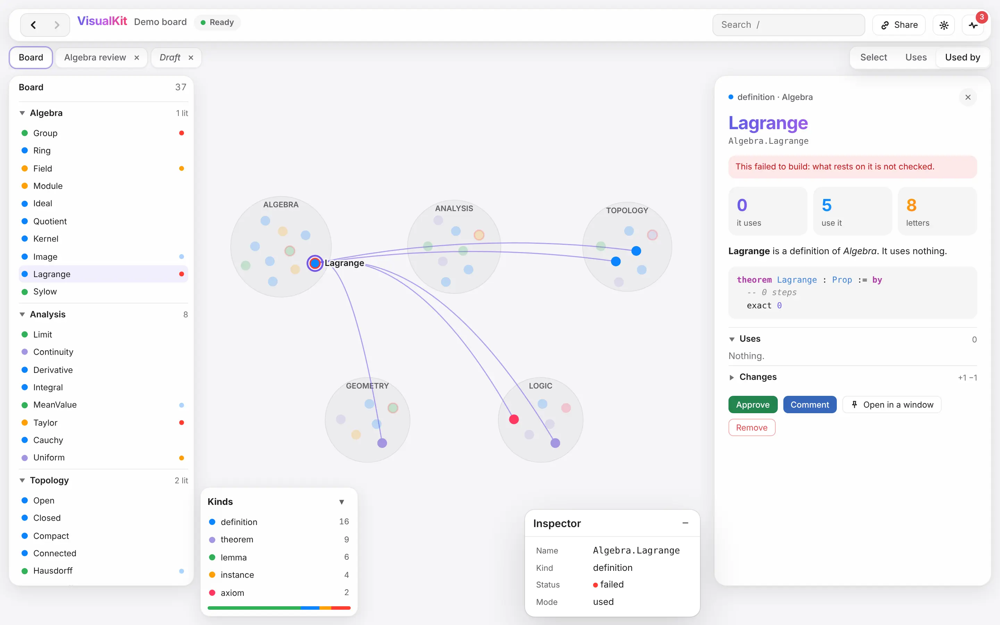
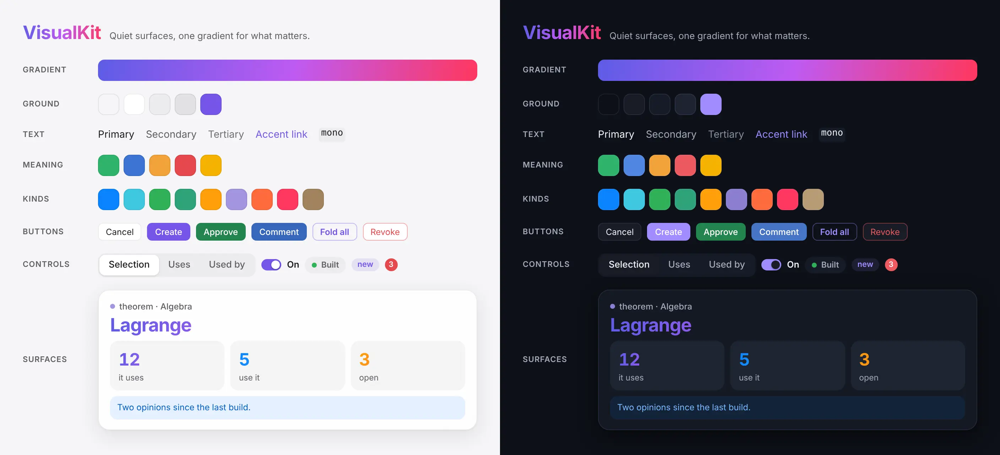
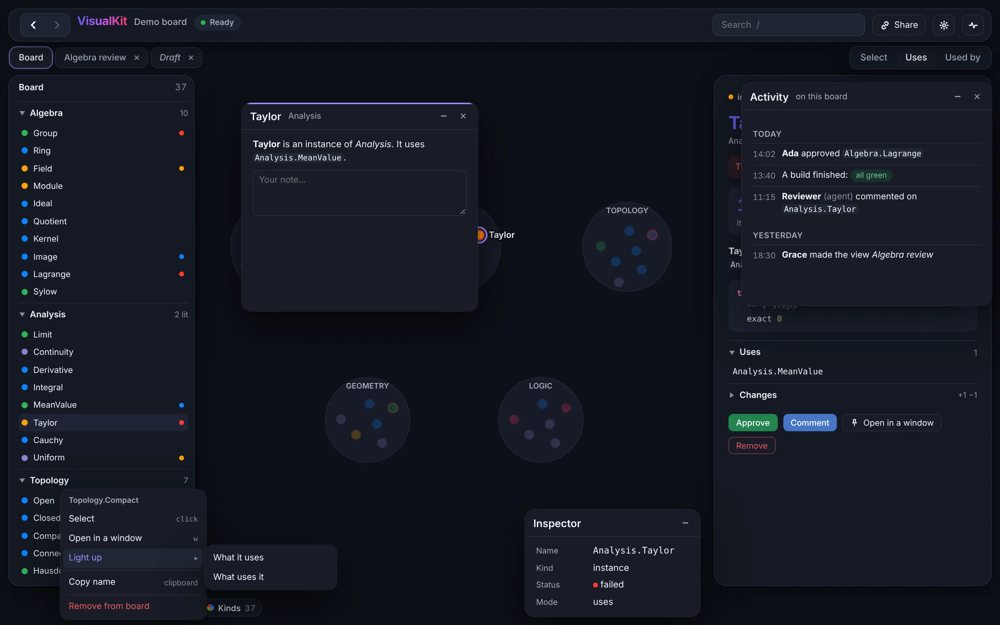
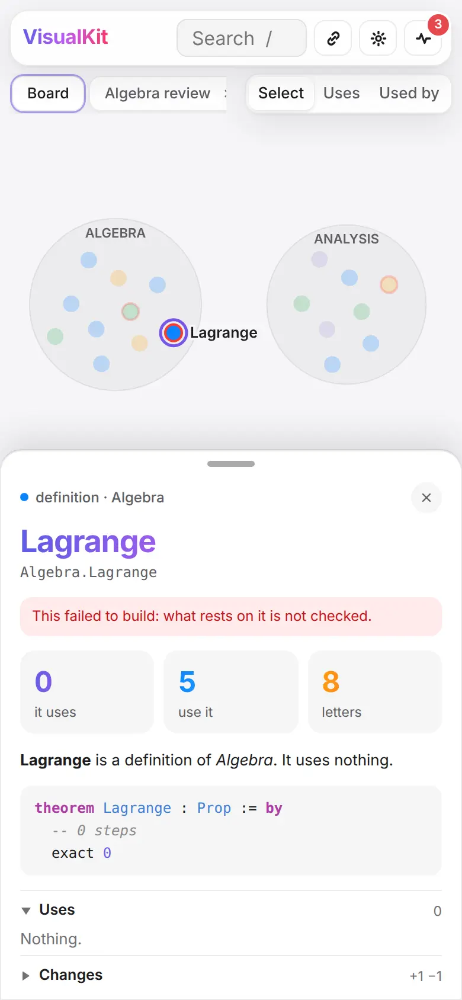
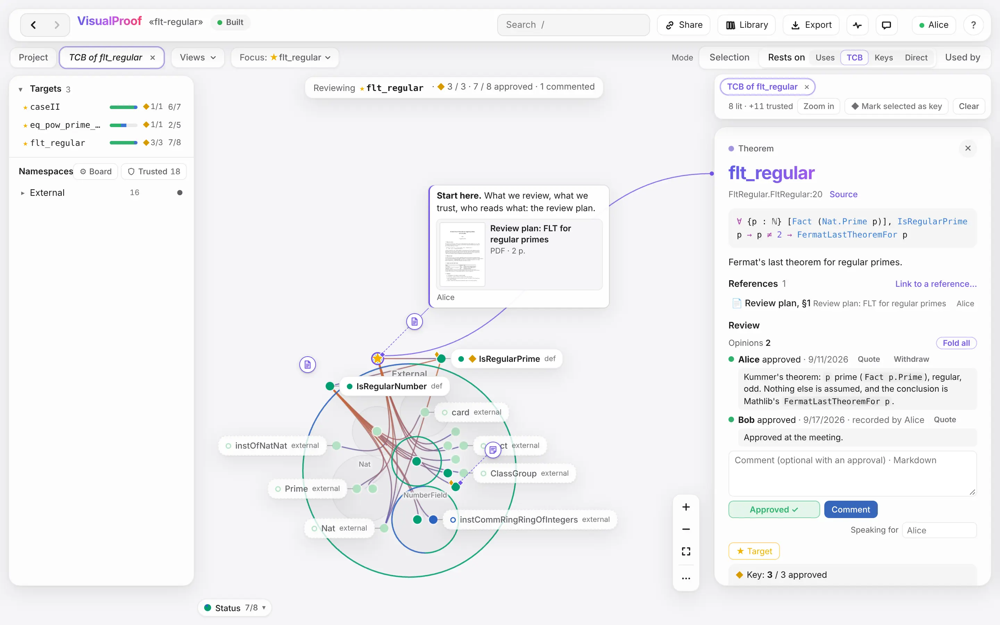

<div align="center">

# VisualKit

**Quiet surfaces, one gradient for what matters.**

The design language and page architecture of [VisualProof](https://github.com/LucianoXu/VisualProof)'s
viewer, distilled into a kit you can build any app with. Plain CSS and TypeScript, no framework,
no runtime dependencies.

[](LICENSE)


</div>

<picture>
  <source media="(prefers-color-scheme: dark)" srcset="docs/images/demo-dark.webp">
  
</picture>

<p align="center"><sub>The demo in <code>demo/</code>, built entirely from the kit. It follows your GitHub theme: light, or <i>Midnight</i>.</sub></p>

## What you get

<table>
<tr>
<td width="33%" valign="top">

### 🎨 Tokens

Colours for light and the blue-black *Midnight* dark, every text step checked at 4.5:1 or more.
One gradient, one accent, colours that mean something, a colour-blind-safe palette. Radii, layers
and motion on one scale.

</td>
<td width="33%" valign="top">

### 🧩 Components

A glass bar, side panel and sliding drawer; floating windows; popovers, a context menu, modals;
buttons, segmented controls, tabs, switches, fields, chips, badges, banners; stats, lists, code,
diffs and light Markdown.

</td>
<td width="33%" valign="top">

### 🧠 Behaviour

Windows that move, resize, snap, collapse to a pill and remember where you put them; menus and
popovers you can drive entirely from the keyboard; focus kept across redraws, and clicks kept through
them; no theme flash on load; reduced motion honoured.

</td>
</tr>
</table>

<p align="center"></p>

<table>
<tr>
<td width="68%" valign="top"></td>
<td width="32%" valign="top"></td>
</tr>
<tr>
<td align="center"><sub>Midnight: floating windows, a context menu with a submenu</sub></td>
<td align="center"><sub>On a phone the drawer is a sheet</sub></td>
</tr>
</table>

## Quick start

```bash
npm install github:LucianoXu/VisualKit
```

```html
<head>
  <!-- sets the theme before the first paint; themeHeadScript("myapp:theme") writes this line -->
  <script>try{var t=localStorage.getItem("myapp:theme");document.documentElement.dataset.theme=t==="dark"?"dark":t==="system"&&matchMedia("(prefers-color-scheme: dark)").matches?"dark":"light"}catch(e){document.documentElement.dataset.theme="light"}</script>
  <link rel="stylesheet" href="visualkit.css">  <!-- bundle visualkit/css -->
</head>
<body class="vk-app">
  <header class="vk-topbar vk-glass">
    <div class="vk-brand"><span class="vk-logo">MyApp</span><span class="vk-brand-sub">Project</span></div>
    <div class="vk-topbar-end"><button class="vk-act" id="share">Share</button></div>
  </header>
  <aside class="vk-side vk-glass">…</aside>
  <aside class="vk-drawer vk-glass" id="drawer">…</aside>
  <div class="vk-windows"></div>
</body>
```

```ts
import { themeKey, Drawer, ContextMenu, contextMenuOn, FloatWindow, confirm, html, icon } from "visualkit";

themeKey("myapp:theme");
const drawer = new Drawer(document.querySelector("#drawer")!);

const menu = new ContextMenu();
contextMenuOn(canvas, menu, ({ x, y }) => ({
  heading: "Board",
  items: [
    { label: "Fit to screen", key: "f", run: fit },
    { label: "Light up", sub: [{ label: "What it uses", run: lightUses }] },
    { label: "Delete", bad: true, sep: true, run: async () => (await confirm({ title: "Delete it?", ok: "Delete", bad: true })) && del() },
  ],
}));
```

The kit ships as source: your bundler (esbuild, Vite, …) compiles the TypeScript, and the CSS is
plain CSS. Take everything with `visualkit/css`, or a layer at a time from `visualkit/css/*`.

## The pieces

| | CSS | TypeScript |
|---|---|---|
| **Theme** | `tokens.css`: `data-theme="dark"` on `<html>` | `setTheme`, `onThemeChange`, `token("--accent")`, `themeChoices`, `reducedMotion` |
| **Bar & panels** | `.vk-topbar` `.vk-strip` `.vk-side` `.vk-drawer` `.vk-sec` | `Drawer`, `insets()` |
| **Floating windows** | `.vk-windows` `.vk-win` `.vk-win-head` `.vk-win-pill` | `FloatWindow`, `storageKeeper`, `cascadeRect` |
| **Popovers & menus** | `.vk-popover` `.vk-menu` `.vk-results` `.vk-hintcard` | `Popover`, `ContextMenu`, `contextMenuOn`, `hint` |
| **Modals** | `.vk-modal` `.vk-modal-box` `.vk-actions` | `confirm`, `ask`, `modal` |
| **Controls** | `.vk-btn` (`primary` `ok` `info` `soft` `bad`) `.vk-act` `.vk-icon` `.vk-nav` `.vk-seg` `.vk-tabs` `.vk-switch` `.vk-input` `.vk-search` | `icon("share")` |
| **Marks** | `.vk-chip` `.vk-badge` `.vk-dot` `.vk-pill` `.vk-banner` `.vk-avatar` `.vk-progress` `.vk-meter` | |
| **Content** | `.vk-title` `.vk-stats` `.vk-row` `.vk-event` `.vk-key` `.vk-dl` `.vk-code` `.vk-diff` `.vk-md` | `markdown`, `html`, `escapeHtml` |
| **Keeping things** | | `keepFocus`, `holdPress`, `focusBack`, `kept`, `trapFocus` |
| **The page** | | `makePage` |

## A page made of parts

VisualProof's viewer is fifty thousand lines of TypeScript with no framework. What keeps it
readable is one rule: **the page is one object, and each concern is a part that wires itself to it.**

```ts
const page = await makePage<Page>(
  { items, selected: null, mode: "select" },                  // what it is given, and its state
  [canvasPart, barPart, sidePart, drawerPart, menuPart, keysPart],  // its table of contents
  { strict: true },                                           // read too early → a named error
);
```

Each part returns what it gives the others; state lives on the page, never in a part; regions are
drawn from state as escaped HTML with the keyboard's place kept; a change is a call, never an event
on a bus. [ARCHITECTURE.md](ARCHITECTURE.md) has the whole of it; [`demo/src/`](demo/src) is a
working page to copy.

## The principles

- **The page is a ground with things floating over it**: nothing docks to an edge; everything sits
  12px in, rounded.
- **Glass for what stays, solid for what is read**: the bar and panels let the content show through,
  blurred; popovers, menus and windows don't.
- **One gradient, used rarely**: the logo, the name of what is selected, a progress line. Nothing
  else.
- **Colour means something, or is not there**: green is good, blue informs, amber asks, red is wrong.
- **Quiet until wanted**: actions show on the row under the pointer; settings live behind an icon;
  hints are said once, under their control.
- **Left out, not greyed**: a menu offers what *this* reader can do *here*.

[DESIGN.md](DESIGN.md) gives each rule with its numbers and its reasons.

## Where it comes from

<a href="https://github.com/LucianoXu/VisualProof"></a>

<p align="center"><sub><a href="https://github.com/LucianoXu/VisualProof">VisualProof</a> shows a Lean codebase's declaration graph and the trusted base of its theorems, for teams reviewing proofs together. VisualKit is its look and its structure without the Lean.</sub></p>

## Develop

```bash
npm install
npm run demo        # the demo at http://localhost:5178, rebuilt on change (and /tokens.html)
npm test            # window geometry, HTML escaping, Markdown, focus keys, held presses, makePage
npm run typecheck
```

Node 22.18 or later.

```
src/css/    tokens · base · controls · surfaces · content   (visualkit.css imports all five)
src/ts/     the primitives; index.ts exports them
demo/       a whole page made of parts, and the token specimen
test/       node --test
```

## License

[Apache-2.0](LICENSE), as VisualProof.
